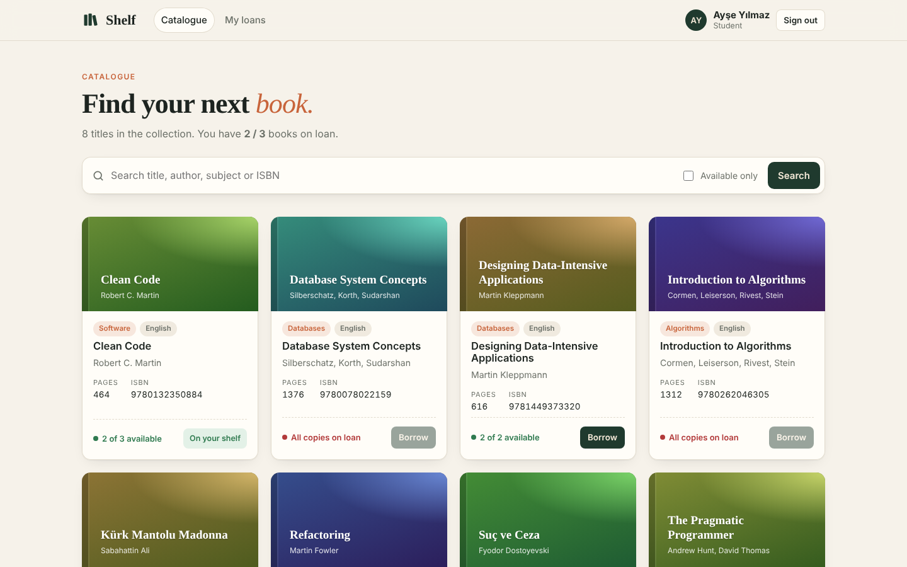
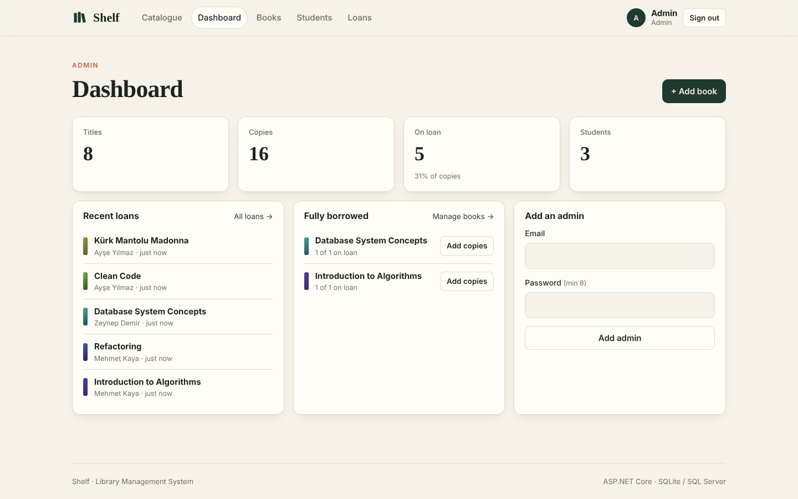

# Shelf — Library Management System

A small library management web app built with **ASP.NET Core (Razor Pages)**.
Students sign up, browse the catalogue and borrow or return books; admins
manage books, students and loans from a dashboard.

It runs out of the box on **SQLite** (no database server needed) and can be
switched to **SQL Server** with two environment variables.



## Quick start

Requires the [.NET 8 SDK](https://dotnet.microsoft.com/download).

```sh
git clone https://github.com/furkanuzel/shelf-library.git
cd shelf-library
dotnet run
```

Open the URL printed in the terminal (for example http://localhost:5000).
On first visit you create the admin account and can add sample books.

## Features

**Students**
- Sign up and sign in
- Search the catalogue by title, author, subject or ISBN; filter to available books
- Borrow up to 3 books at a time, see current loans and return them

**Admins**
- Dashboard: titles, copies, books on loan, students, recent loans, fully borrowed titles
- Add, edit and remove books; change number of copies
- Edit and remove students
- See every active loan and check returned books in
- Add more admins

**Under the hood**
- Loans live in their own table, so one title can have several copies out at once.
  Availability = total copies − active loans.
- Lending runs in a serializable transaction (no double-lending the last copy).
- Books or students with active loans can't be deleted; copies can't drop below
  the number on loan.
- Passwords are hashed with PBKDF2-SHA256 (210k iterations, per-user salt).
- Cookie authentication with Student / Admin roles; anti-forgery tokens on every form;
  all SQL is parameterised.
- Responsive layout with automatic dark mode.



## Using SQL Server

```powershell
$env:LMS_PROVIDER = "sqlserver"
$env:LMS_CONNECTION = "Server=(localdb)\MSSQLLocalDB;Database=LMS;Trusted_Connection=True;TrustServerCertificate=True"
dotnet run
```

The database must exist; tables are created automatically on first run.

| Variable         | Values                     | Default                           |
| ---------------- | -------------------------- | --------------------------------- |
| `LMS_PROVIDER`   | `sqlite`, `sqlserver`      | `sqlite`                          |
| `LMS_CONNECTION` | provider connection string | `Data Source=library.db` (SQLite) |

## Project structure

```
Program.cs              app setup: auth, roles, first-run redirect
Pages/                  Razor Pages (catalogue, account, my loans, admin)
src/LibraryService.cs   business rules (loans, stock, accounts)
src/Database.cs         provider selection + small ADO.NET helpers
src/Schema.cs           idempotent schema for SQLite and SQL Server
src/PasswordHasher.cs   PBKDF2 password hashing
src/Web.cs              shared page helpers
wwwroot/css/site.css    styles
```
